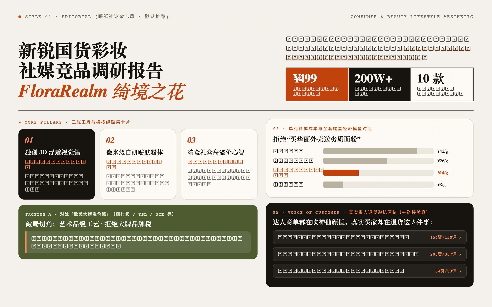
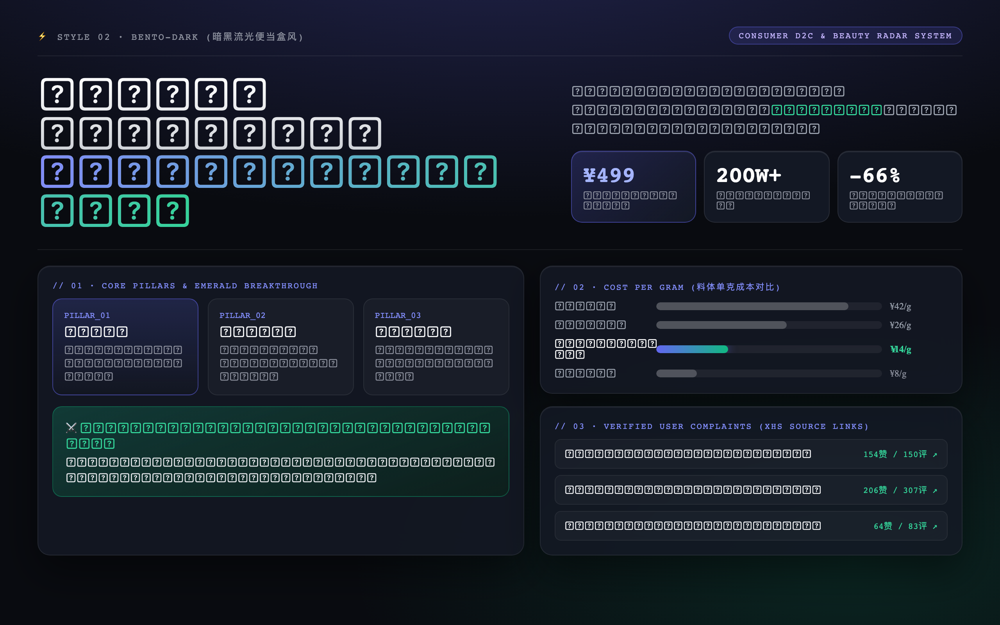
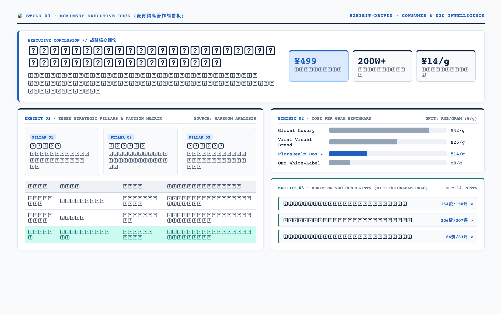
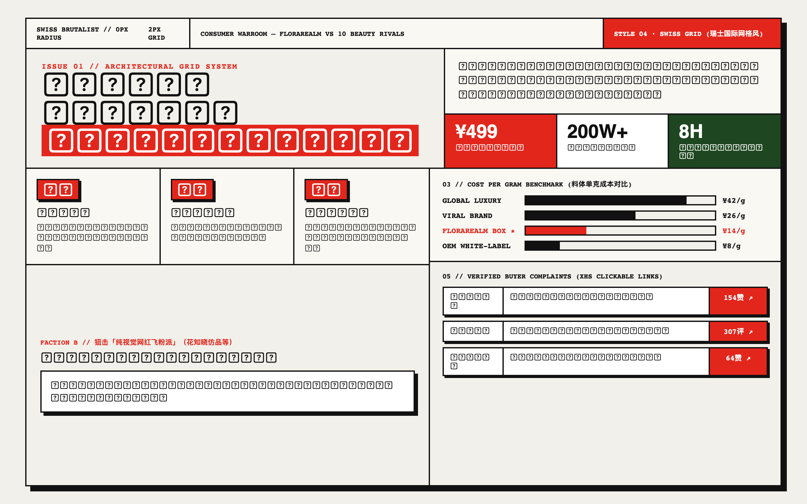
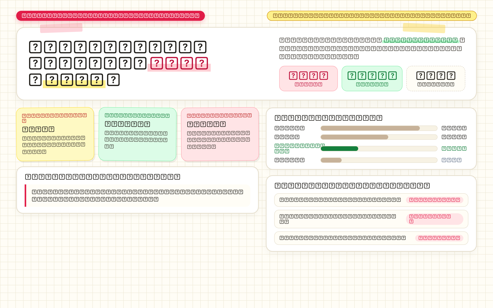

# ⚔️ Social Competitor Warroom（社媒竞品作战室 · 海内外全平台 × 全品类版）

> **把零散的海内外竞品信息，一键炼成「给老板 / 投资人 / 营销总监汇报级」的社媒竞品攻防作战室与交互式高颜值 HTML 研报。**  
> 深度融合 [`competitor-kol-radar`](https://github.com/waynefu2020/competitor-kol-radar) 采集分析脚本管线 · 支持 **YouTube / TikTok / Instagram / Reddit / 小红书 / 抖音 / B站**  
> 适配 **AI 软件 & SaaS / 移动 App / 美妆个护 D2C / 新消费品 / 智能硬件** 全品类  
> Compatible with **Claude Code · Google Antigravity · Cursor · Windsurf · Codex · OpenClaw**

[](LICENSE)
[](SKILL.md)
[](references/overseas-and-cross-category-playbook.md)
[](https://github.com/Panniantong/Agent-Reach)

---

## ✨ 为什么需要这个 Skill？

普通的 AI 竞品调研只会罗列枯燥的「产品 A 卖点、产品 B 价格」静态表格。而真正能帮新品打赢上市战役与出海增长的**社媒竞品作战室**，一次性为你解决 **6 大战略与执行难题**：

1. **全品类自适应拆解（不仅限于硬件）**：自动识别 **AI 软件/SaaS/App**（如 Manus、Granola、Wispr Flow、Gamma）、**美妆个护 D2C**（如花知晓 Flower Knows）、**智能硬件**（如 Plaud、录音卡）与**教育/消费品**，动态切换卖点、留存飞轮与渠道转化指标。
2. **海内外红人商单「赞助指纹深挖（Sponsor Fingerprint）」**：不止搜品牌词，更能从 YouTube / TikTok / IG / B站 / 小红书描述栏中**逆向提取专属商单追踪短链与兑换码**（如 `go.granola.ai/名`、`manus.im/redeem?c=码`、`ref.wisprflow.ai/名`、`gamma.yt.link/码`），精准剥离**「明确付费赞助（口播植入 vs 垂直专场）」**、**「PR 礼盒寄样」**、**「分佣联盟/底栏常驻工具单」**与**「纯自然自来水」**。
3. **必拆「🟢 爆款内容 vs 🔴 效果差的内容」**：用真实播放中位数告诉你竞品哪类内容跑出了百万播放（如*泛高净值理财/商业播客 30-60s 口播植入*、*丢给 AI 一个真实完整项目一镜到底挑战*），哪类内容彻底扑街（如*纳米号拆分的机械式功能说明书 SEO 教程，仅几十播放*），帮团队直接省下试错预算。
4. **四大派别进攻话术（4-Faction Battle Matrix）**：把市面上 5~15 款竞品归入 4 个典型流派，针对每一派的软肋给出一针见血的销售/种草反击金句。
5. **3 年真实持有总成本 (TCO) / 订阅与礼盒经济模型精算**：撕开「硬件便宜订阅贵」或「免费试用扣费陷阱」的伪装，算清硬件 36 个月 TCO、SaaS Token/Pro 年费或美妆全套礼盒（Full-Set Box）的真实账单。
6. **100% 带原帖链接验真的真实用户吐槽（Voice of Customer）**：严格过滤品牌公关软文，深挖小红书避坑帖、YouTube/TikTok/B站评论区高赞反水评论、Reddit (`r/...`) 与 App Store 1~3 星差评，**每一条吐槽均附带可点击验真的原帖链接（含 `xsec_token` 或视频直达 URL）**。

---

## 🌍 全品类 × 海内外平台自适应矩阵

| 品类赛道 | 典型对标案例 | 核心拆解重心（自动适配） | 主力社媒与差评采集阵地 |
| :--- | :--- | :--- | :--- |
| **💻 AI 软件 / SaaS / App** | Manus, Granola, Wispr Flow, Gamma, Genspark | 60% 泛高净值频道口播植入 + 40% 真项目一镜到底专场；定制短链归因；1~3个月免费 Pro / 积分钩子；订阅年费与额度限制 | YouTube, X/Twitter, Reddit, Product Hunt, B站, 小红书 |
| **💄 美妆 / 个护 / 潮流 D2C** | Flower Knows (花知晓), Casetify, 完美日记 | 包装视觉锤与开箱分享欲（Unboxing）；PR 礼盒寄样 vs 联盟分佣；Full-Set 礼盒客单价；TikTok Shop / Ulta / 线下快闪店 (`#popup`) | TikTok, Instagram Reels, YouTube Shorts, 小红书, 抖音 |
| **🎙️ 智能硬件 / 消费电子** | Plaud, 录音卡, 极米手环, 运动相机 | 硬件形态与底层软件体验；硬件买断价 + 36个月隐形订阅税 (3-Year TCO)；跨生态联动（如 MCP 工作流）；退货党评论区截流 | 小红书, 抖音, YouTube, TikTok, Amazon Reviews, Reddit |
| **🎓 教育 / 知识服务 / 工具** | Turbo AI, Studley AI, Coconote, 得到 | 结果交付承诺（如 4.0 GPA / 提分 / 知识库发芽）；免费转付费漏斗；校园/私域社群裂变 | TikTok, App Store / Google Play 评论, 小红书, 视频号 |

---

## 🎨 内置 5 套 Dribbble 殿堂级视觉风格（先看预览图，5 选 1 生成）

生成 HTML 报告前，Skill 会直接向你展示以下 **5 张高分辨率风格预览图**（以下以大众消费品/新锐美妆个护《FloraRealm 绮境之花》实战拆解为例，也可双击打开 [`resources/dribbble-style-picker.html`](resources/dribbble-style-picker.html) 实时交互预览），由你**任选 1 种**生成独立单文件 HTML：

| 风格代码 | 风格名称 | 视觉基因与排版骨架 | 最适合场景 |
| :--- | :--- | :--- | :--- |
| `editorial` | **① 暖纸社论杂志风** *(默认推荐)* | *Kinfolk* / *Monocle* 杂志感 · 米白暖纸底 `#F4F1EA` + 爱马仕橙 `#C2410C` + 橄榄绿破局卡 | 给老板 / 合伙人 / 投资人深度阅读、品牌战略复盘 |
| `bento-dark` | **② 暗黑流光便当盒风** | Linear / Raycast 质感 · 深邃曜石黑 `#090B10` + 1px 微光边框 + 翡翠绿/靛蓝高亮 | AI 产品、智能硬件、SaaS、科技新品发布会作战室 |
| `mckinsey` | **③ 麦肯锡高管作战看板** | Pitch / Stripe 商务尽调风 · 纯净白灰底 + 深海蓝 `#0B1F3A` + Action Title 结论先行 | 正式商业立项汇报、投融资尽调、B2B 企业服务 |
| `swiss` | **④ 瑞士国际主义网格风** | Readymag / Pentagram 先锋风 · `2px solid #111` 粗黑网格线 + 0圆角硬边阴影 + 瑞士红 `#E3261C` | 潮流硬件、设计驱动品牌、超级个体/独立开发者 |
| `xhs-craft` | **⑤ 小红书原生手账拆解风** | 小红书万赞干货笔记感 · 方格手账纸 `#FFFDF6` + 荧光笔半截涂抹 + 和纸胶带便利贴 | 社媒运营团队脑暴、美妆/生活方式、直接截图发小红书 |

#### ① 暖纸社论杂志风 (`editorial` · 默认推荐)


#### ② 暗黑流光便当盒风 (`bento-dark`)


#### ③ 麦肯锡高管作战看板 (`mckinsey`)


#### ④ 瑞士国际主义网格风 (`swiss`)


#### ⑤ 小红书原生手账拆解风 (`xhs-craft`)


---

## 📦 一键安装

### 方式一：使用 `npx skills` 安装（推荐）

```bash
npx skills add waynefu2020/social-competitor-warroom
```

### 方式二：Git Clone 到本地技能目录

**Claude Code（全局或项目级）：**
```bash
git clone https://github.com/waynefu2020/social-competitor-warroom.git ~/.claude/skills/social-competitor-warroom
```

**Google Antigravity / Cursor / OpenClaw（项目级 `.agents/skills`）：**
```bash
git clone https://github.com/waynefu2020/social-competitor-warroom.git .agents/skills/social-competitor-warroom
```

---

## 🔌 双轨制数据采集配置（按需启用）

本技能支持**零配置直接上传本地文件（Excel / CSV / PDF / Markdown）或免费联网开箱即用**。同时内置了完整的跨平台自动化采集脚本群（`scripts/`）：

1. **轨道 A：TikHub API + `yt-dlp` 混合极速采集（推荐，支持海内外批量拉取）**
   ```bash
   export TIKHUB_API_KEY="your_tikhub_api_key"
   # 或写入 ~/.config/tikhub/key
   ```
   - 支持 **YouTube 近 1 年赞助商单指纹深挖**（`scripts/yt_sponsor_radar.py`，自动用 `yt-dlp` 补齐缺失日期与播放量）
   - 支持 **TikTok / Instagram / YouTube / 小红书 / 抖音** 批量搜索、作者粉丝补全与**高赞评论区槽点自动提取**（`scripts/collect.py`, `scripts/domestic.py`, `scripts/comments.py`）
2. **轨道 B：零成本免费方案（Agent 联网调研 + [Panniantong/Agent-Reach](https://github.com/Panniantong/Agent-Reach)）**
   > ⚠️ 注意：请勿直接从 PyPI `pip install agent-reach`（存在同名冲突包），请使用官方 GitHub Release 安装：
   ```bash
   uv tool install https://github.com/Panniantong/Agent-Reach/releases/latest/download/agent-reach.zip
   agent-reach setup
   agent-reach add xiaohongshu   # 按提示扫码或导入小红书 Cookie
   agent-reach doctor            # 检查小红书/抖音/B站/YouTube/Exa 通道状态
   ```

---

## 🚀 快速开始（Prompt 示例）

### 场景 1：海外 AI 软件 / SaaS 的 YouTube & 社媒红人投放深挖
> 「帮我用 `social-competitor-warroom` 抓取 **Granola、Manus、Wispr Flow、Gamma** 最近 1 年在 YouTube 上的付费合作视频清单。要求通过赞助短链指纹区分『明确付费口播植入』、『垂直专场』与『底栏常驻外链』，拆解每家的目标人群、核心卖点、3条代表种草视频（带链接）、博主画像、爆款 vs 效果差的内容规律，并生成一份报告。」

### 场景 2：消费品 / 美妆出海（TikTok + IG + YouTube）红人打法拆解
> 「我们想研究 **Flower Knows（花知晓）** 在海外 TikTok、Instagram 和 YouTube 近 90 天的红人营销与渠道转化打法。请帮我分析它是买量型还是自来水型、各粉丝量级博主表现、评论区真实痛点，并输出一份可以拿去开会的 HTML 竞品报告。」

### 场景 3：国内新品上市（小红书 / 抖音 / B站）全维攻防作战室
> 「这是我们的竞品资料（或飞书文档链接），请帮我深扒赛道内 8~10 款竞品在小红书和 B 站的种草套路与真实素人避坑帖（每条吐槽必须带真实可点击原帖链接），精算 3 年持有总成本，提炼四大派别进攻话术，并让我从 5 套 Dribbble 视觉风格中选 1 种生成 HTML 网页。」

---

## 📂 仓库目录结构

```text
social-competitor-warroom/
├── SKILL.md                                         # 核心技能指令与海内外全品类 6 步 SOP
├── scripts/                                         # 自动化数据采集、赞助指纹雷达与评论槽点分析脚本
│   ├── yt_sponsor_radar.py                          # YouTube 半年/1年赞助短链指纹深挖 + yt-dlp 混合补全
│   ├── collect.py                                   # 海外 TikTok / Instagram / YouTube 批量采集
│   ├── domestic.py                                  # 国内小红书（蒲公英）+ 抖音（星图）批量采集
│   ├── comments.py                                  # 跨平台高赞评论拉取与「吐槽/问价/疑虑/认可」信号分类
│   ├── normalize.py                                 # 去噪清洗、5级商业属性判定与 20 条样本抽查
│   ├── analyze.py                                   # 统计中位数、量级性价比、打法画像与对标库定位
│   ├── labels.py                                    # 博主赛道与「内容形式×沟通人群×卖点」标注统计
│   ├── agent_reach_import.py                        # 无 TikHub Key 时的 Agent-Reach (yt-dlp/xhs-cli) 免费导入
│   ├── tikhub.py / common.py / lexicons.py / doctor.py
├── references/
│   ├── overseas-and-cross-category-playbook.md      # 海外竞品 & 全品类（SaaS/美妆/硬件/教育）自适应作战手册
│   ├── data-collection-playbook.md                  # 双轨采集手册（TikHub API + Panniantong/Agent-Reach）
│   ├── methodology.md / pitfalls.md                 # 统计口径、打法画像判定与 25 个实战防坑清单
│   ├── platforms-overseas.md / platforms-domestic.md# 海内外各平台 API 字段与指标解析规范
│   ├── channel-signals.md / audience-research.md    # 转化渠道信号解读 & 多竞品新人群投放研究方法
│   ├── dribbble-5-styles.md                         # 5 套 Dribbble 视觉风格完整 CSS 变量与排版规范
│   └── feishu-sync-guide.md                         # 飞书文档（lark-cli）读取与带链接回写指南
├── resources/
│   ├── previews/                                    # 5 套 Dribbble 视觉风格 2x Retina 预览大图 (PNG)
│   ├── dribbble-style-picker.html                   # 5 套 Dribbble 视觉风格实时交互预览画廊
│   └── editorial-report-reference.html              # 780+ 行完整单文件 HTML 标杆模板（已脱敏演示版）
├── assets/
│   └── brief.example.json                           # 跨平台竞品采集配置模板
├── README.md
└── LICENSE
```

---

## 📄 License

MIT License © 2026 [waynefu2020](https://github.com/waynefu2020)
