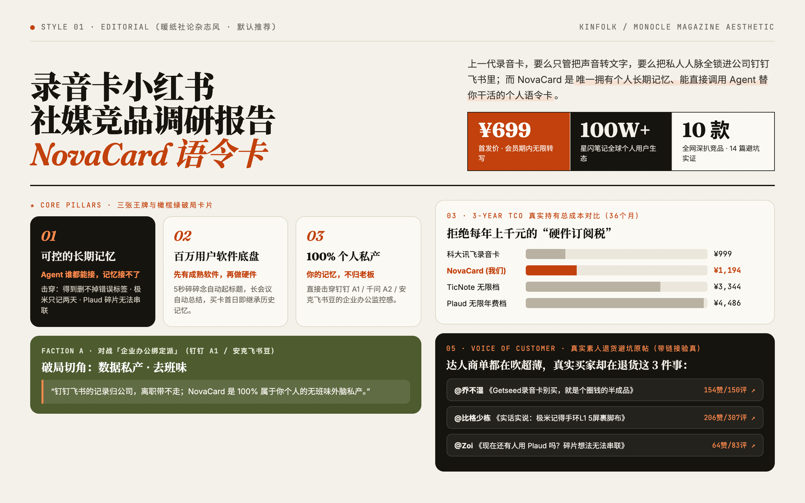
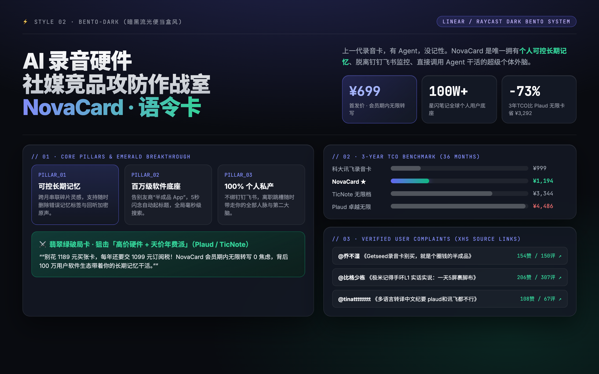
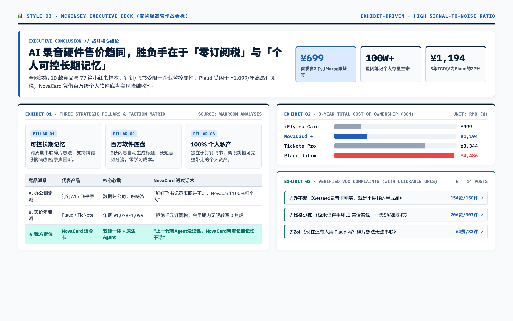
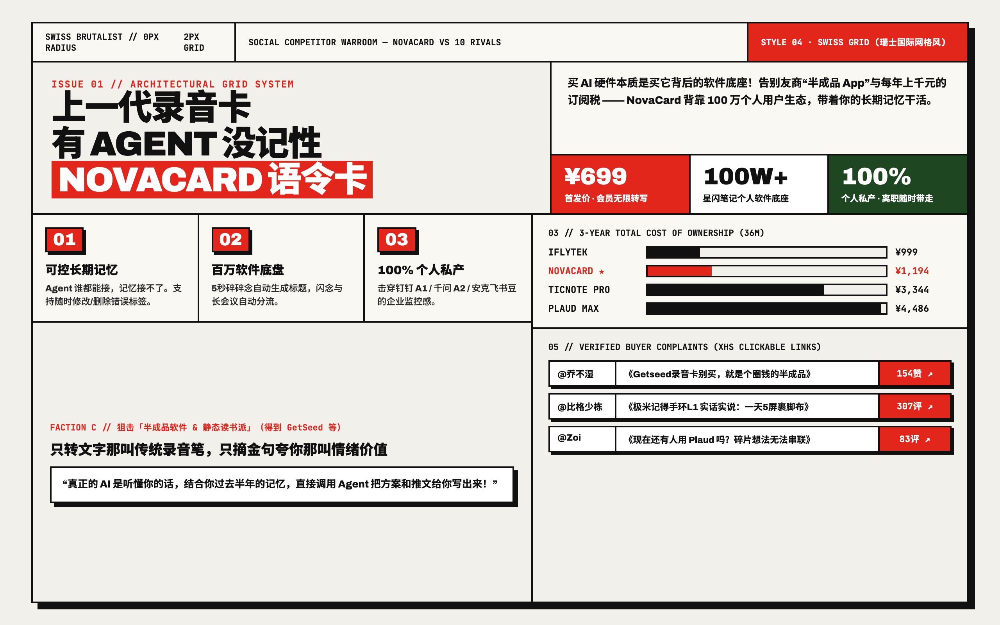
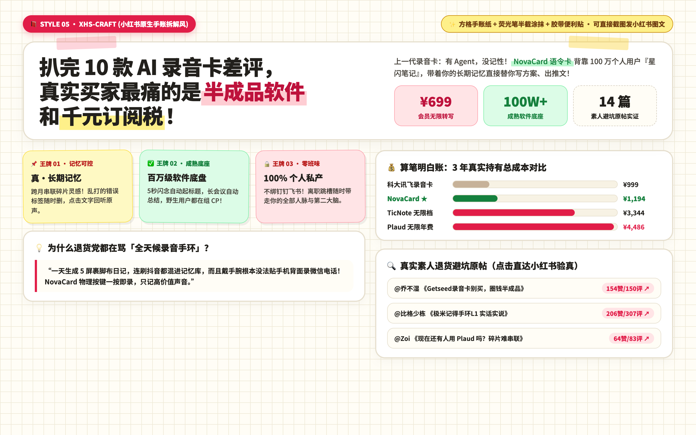

# Dribbble 5 大高阶视觉设计系统规范（供用户 5 选 1）

在进入 HTML 报告生成阶段前，先打开或展示 [resources/dribbble-style-picker.html](../resources/dribbble-style-picker.html)（也可结合 `ask_question` 工具列出这 5 个选项），**让用户从以下 5 种 Dribbble 热门视觉风格中选定 1 种**，随后 strictly 按照用户选定的那 1 种视觉规范输出干净纯粹的单文件 HTML 报告。

---

## 报告共性骨架（5 种风格共享的 7 大核心章节）

无论用户选择哪一种视觉风格，报告的数据密度与叙事逻辑必须完整包含以下 **7 大模块**：
1. **`Hero`（首屏破题）**：刊头元数据 + 超大主标题 + 一句话代际定义（Thesis，带高亮标记）+ 章节目录 + 3 个核心指标卡（首发价/权益、我方存量生态规模、调研竞品数）。
2. **`#s0 ★ 核心卖点 · 三张王牌`（Core Pillars）**：3 张立柱卡（`01` 主推王牌深色高亮 + `02` + `03`），每张含编号、大标题、一句话定性（Lead）、正文阐述、底部 `击穿 / 证据` 标签栏。
3. **`#s1 01 差异化点 · 四大派别进攻话术`（Battlecards）**：1 句大号引言（Pull Quote）+ `2×2` 四大竞品派别攻防卡（每张含背景字母水印 A/B/C/D、代表竞品圆点标签、派别名称、破局角度胶囊、痛点拆解、底部金句 Blockquote）。
4. **`#s2 02 社媒渠道打法`（Channel Playbook）**：`01` ~ `05` 五套已验证打法条带，每行 4 列：`编号` | `打法名称与场景` | `竞品真实数据支撑（超大数字 + 描述）` | `我方落地策略（高亮底色框 + 3条 Bullet）`。
5. **`#s3 03 价格与订阅格局`（Pricing & 3-Year TCO）**：左 8 列「硬件/首购日常价横向动态条形图（标注到期订阅成本）」+ 右 4 列「订阅税洞察黑卡」+ 下 12 列「3 年真实持有总成本 (TCO) 对比表（含双色进度条与底部两栏结论：对谁打价格战 vs 对谁不拼价格打功能）」。
6. **`#s4 04 竞品档案`（Competitor Profiles）**：3 张赛道共性概览卡 + 形态/派系动态筛选按钮（`全部 / 形态A / 形态B / 生态绑定`）+ 竞品网格卡片（我方产品独占顶部 3 列通栏黑金/高亮卡；竞品每行 3 张，含价格、人群、卖点胶囊、`THEIR ATTACK 进攻话术` 色块、以及 `<details>` 折叠的背书/渠道/额度/可点击种草案例链接）。
7. **`#s5 05 真实用户吐槽分析 & #s6 06 野生自来水实证`（VOC & Organic Proof）**：
   - `#s5`：巨型核心洞察横幅（5个痛点胶囊）+ 按产品形态拆解的 **「左栏：用户集中吐槽点 vs 右栏：我方破局打法」** 双栏对比 + 下方 2 列网格排布的 **「真实素人避坑原帖直达胶囊卡片（带首字母头像、标题、@博主、赞评数、真实原帖链接）」**。
   - `#s6`：2 张野生自来水实证卡（带原帖链接）+ 「补齐最后一块拼图」通栏卡 + 底部虚线框「Next Action · 高意向评论区截流靶标按钮组」。

---

## 风格 1：暖纸社论杂志风 (`editorial` · Kinfolk / Monocle Editorial) —— 【默认最推荐】
> **完全复刻 内置 Editorial 经典暖白研报模板 的经典高雅质感**，适合给老板、合伙人、投资人深度阅读。



- **色彩 Token**：
  ```css
  :root {
    --paper: #F4F1EA; --paper-2: #ECE7DC; --card: #FBF9F4;
    --ink: #16140F; --ink-2: #4A463D; --ink-3: #8A8477;
    --line: rgba(22,20,15,.12);
    --accent: #C2410C; --accent-soft: #F6E1D3;
    --olive: #4D5B2F; --olive-soft: #E3E6D3;
    --r: 20px;
  }
  ```
- **字体排印**：
  - 中文大标题：`Noto Serif SC`（思源宋体 700/900），字号 `clamp(40px, 6.4vw, 88px)`，字距 `-0.02em`
  - 英文大数字与编号：`Instrument Serif`（衬线体），字号 `52px ~ 96px`
  - 正文：`Noto Sans SC`，`15px`，行高 `1.75`
  - 标签/元数据：`JetBrains Mono`，`11px~12px`，大写 `letter-spacing: 0.08em`
- **标志性视觉细节**：
  - 顶部 3px 爱马仕橙阅读进度条 + 毛玻璃吸顶导航
  - 第一张王牌卡与我方产品卡采用炭黑底（`#16140F`）配暖橙高亮字（`#FF8A4C`）
  - 痛点破局右栏采用整块橄榄绿底（`#4D5B2F`）配浅米绿字，视觉对比极度舒适

---

## 风格 2：暗黑流光便当盒风 (`bento-dark` · Linear / Raycast Dark Bento)
> **Dribbble 科技榜第 1 名的暗黑玻璃拟态 Bento 风格**，适合 AI 产品、智能硬件、SaaS 工具路演投屏。



- **色彩 Token**：
  ```css
  :root {
    --paper: #090B10; --paper-2: #121622; --card: #131824;
    --ink: #F3F4F6; --ink-2: #9CA3AF; --ink-3: #64748B;
    --line: rgba(255,255,255,.08);
    --accent: #6366F1; --accent-soft: rgba(99,102,241,.16);
    --olive: #059669; --olive-soft: rgba(16,185,129,.14);
    --r: 20px;
  }
  ```
- **字体排印**：
  - 标题与正文：`Inter`, `Plus Jakarta Sans`, `Noto Sans SC`（现代几何无衬线 800）
  - 数字与指标：`JetBrains Mono` 或 `Inter 900`，配径向微光渐变文字
- **标志性视觉细节**：
  - 页面背景带微弱顶部靛蓝聚光灯（`radial-gradient(60% 35% at 50% 0%, rgba(99,102,241,.18), transparent)`）与 `24px` 科技暗格纹
  - 所有卡片采用 `1px solid rgba(255,255,255,.08)`，鼠标悬停时边框亮起靛蓝微光（`border-color: rgba(99,102,241,.5)`）并轻微上浮
  - 破局列采用深邃翡翠绿微光渐变底（`linear-gradient(160deg, rgba(16,185,129,.22), #0D1F1C)`）

---

## 风格 3：麦肯锡高管作战看板 (`mckinsey` · Pitch / Stripe Executive Deck)
> **冷峻、精准、高信噪比的华尔街投行与顶级咨询公司汇报风格**，适合正式商业立项会与投融资尽调。



- **色彩 Token**：
  ```css
  :root {
    --paper: #F8FAFC; --paper-2: #EEF2F6; --card: #FFFFFF;
    --ink: #0B1F3A; --ink-2: #334155; --ink-3: #64748B;
    --line: #E2E8F0;
    --accent: #1F5FBF; --accent-soft: #DBEAFE;
    --olive: #0F766E; --olive-soft: #CCFBF1;
    --r: 10px;
  }
  ```
- **字体排印**：
  - 标题与正文：`IBM Plex Sans`, `Noto Sans SC`（700/800），克制严谨
  - 数字与表格：`IBM Plex Mono`（等宽对齐，方便财务与成本核对）
- **标志性视觉细节**：
  - 卡片顶部带 `3px solid #0B1F3A` 或 `#1F5FBF` 顶部色条（Exhibit 展板风格），圆角较小（`10px`），带轻微商务投影
  - 每个章节标有 `EXHIBIT 01` ~ `EXHIBIT 06` 编号与底部数据来源行

---

## 风格 4：瑞士国际主义网格风 (`swiss` · Readymag / Pentagram Brutalist)
> **先锋设计工作室偏爱的瑞士网格与新粗野主义（Neo-Brutalism）**，适合潮流硬件、设计驱动品牌、超级个体。



- **色彩 Token**：
  ```css
  :root {
    --paper: #F2F0EA; --paper-2: #E5E2D9; --card: #FAF8F3;
    --ink: #111111; --ink-2: #2B2B2B; --ink-3: #666666;
    --line: #111111;
    --accent: #E3261C; --accent-soft: #FADBD8;
    --olive: #1E4620; --olive-soft: #D4EFDF;
    --r: 0px;
  }
  ```
- **字体排印**：
  - 标题与巨型数字：`Archivo Black`, `Inter`, `Noto Sans SC`（900 极粗），字距紧凑 `-0.04em`
- **标志性视觉细节**：
  - **0 圆角直角设计（`--r: 0px`）** + `1.5px ~ 2px solid #111111` 建筑感实黑分割线
  - 卡片悬停时产生硬边位移阴影（`box-shadow: 6px 6px 0 #111`）
  - 瑞士高饱和红（`#E3261C`）色块与超大几何编号形成极强视觉冲击

---

## 风格 5：小红书原生手账拆解风 (`xhs-craft` · GoodNotes Viral Craft)
> **小红书万赞干货博主的方格纸 + 荧光笔 + 便利贴手账风格**，不仅好看，还能直接按模块截图发小红书图文。



- **色彩 Token**：
  ```css
  :root {
    --paper: #FFFDF6; --paper-2: #F7F2E4; --card: #FFFFFF;
    --ink: #22201C; --ink-2: #4A463F; --ink-3: #8C857B;
    --line: #E6DFCE;
    --accent: #E11D48; --accent-soft: #FFE4E6;
    --olive: #15803D; --olive-soft: #DCFCE7;
    --r: 18px;
  }
  ```
- **字体排印**：
  - 标题：`Noto Sans SC` 900 圆润黑体，重点词默认带半截荧光黄涂抹背景（`linear-gradient(transparent 55%, #FEF08A 55%)`）
- **标志性视觉细节**：
  - 全局背景自带 `20px × 20px` 浅米色手账方格纸纹理（`linear-gradient(#EFEAD8 1px, transparent 1px)`）
  - 核心卡片带半透明粉色/黄色和纸胶带装饰条与轻微手账纸张阴影
